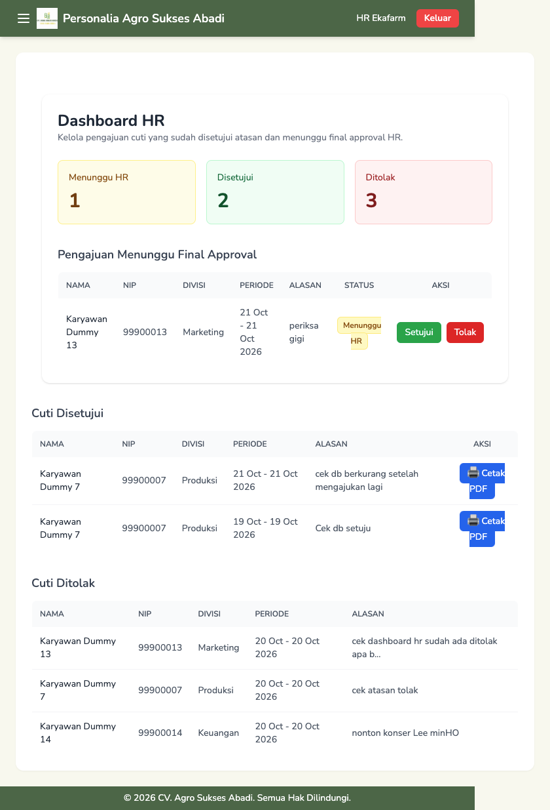

# 🌿 Personalia Agro Sukses Abadi - Leave Management System

Sistem manajemen cuti karyawan berbasis web untuk lingkungan **Agro Sukses Abadi**. Proses pengajuan cuti yang sebelumnya dikelola lewat Google Docs dipindahkan ke aplikasi yang dihosting sendiri, supaya manajemen punya gambaran terpusat tentang siapa yang sedang atau akan cuti, dan karyawan bisa melihat sisa cutinya dalam setahun.

Dibangun dari nol dengan **Laravel 12** dan **Tailwind CSS v4**. Seluruh data pada repositori ini adalah **data dummy**.



---

## 🔄 Alur Persetujuan

```
Karyawan mengajukan  →  Atasan divisi  →  HR  →  Disetujui (jatah cuti berkurang)
                              ↓              ↓
                           Ditolak        Ditolak
```

- Atasan hanya dapat memproses pengajuan dari **divisinya sendiri** (divalidasi di sisi server, bukan hanya disembunyikan di tampilan).
- Perubahan status hanya sah dari tahap yang sesuai, jadi pengajuan yang sudah diproses tidak bisa ditimpa.
- HR memberi persetujuan akhir dan dapat mencetak surat cuti dalam format PDF.

---

## 🚀 Fitur

| Status | Fitur | Keterangan |
| :----: | :---- | :--------- |
| ✅ | Autentikasi multi-role | Karyawan, Atasan, dan HR, login menggunakan NIP |
| ✅ | Pengajuan cuti | Hari kerja dihitung otomatis (tanpa Sabtu, Minggu, dan libur nasional) |
| ✅ | Validasi hak cuti | Aktif setelah 12 bulan masa kerja, dan sisa cuti dicek saat mengajukan |
| ✅ | Dashboard karyawan | Statistik pengajuan, riwayat, dan sisa cuti tahunan |
| ✅ | Dashboard atasan | Pengajuan divisi (setujui atau tolak) beserta riwayat |
| ✅ | Dashboard HR | Rekap global, final approval, riwayat disetujui dan ditolak |
| ✅ | Cetak surat cuti PDF | Format A4 dengan area tanda tangan dan catatan atasan |
| ✅ | CRUD data karyawan (HR) | Tambah, ubah, hapus, dan reset password |

---

## 🧪 Menjalankan Demo

Membutuhkan **PHP 8.2+**, **Composer**, **Node.js**, dan **MariaDB/MySQL**.

```bash
git clone https://github.com/wahyu043/personalia-agro-sukses-abadi.git
cd personalia-agro-sukses-abadi

composer install
npm install && npm run build

cp .env.example .env
php artisan key:generate
```

Atur koneksi database di `.env` (database kosong yang sudah dibuat):

```env
DB_CONNECTION=mysql
DB_HOST=127.0.0.1
DB_PORT=3306
DB_DATABASE=nama_database
DB_USERNAME=root
DB_PASSWORD=
```

```bash
php artisan migrate --seed
php artisan storage:link
php artisan serve
```

Buka <http://127.0.0.1:8000>.

> Catatan: salah satu migrasi memakai sintaks MySQL/MariaDB, jadi SQLite belum didukung.
> Seeder demo menolak berjalan di environment `production`.

### Akun demo

Login menggunakan **NIP**. Semua akun berpassword `password`.

| Peran | NIP | Divisi |
| :---- | :-- | :----- |
| HR | `HR` | - |
| Atasan | `SPV-PROD` | Produksi |
| Atasan | `SPV-KEU` | Keuangan |
| Atasan | `SPV-MKT` | Marketing |
| Karyawan | `99900007` | Produksi |
| Karyawan | `99900014` | Keuangan |
| Karyawan | `99900013` | Marketing |

Coba alurnya: login sebagai karyawan dan ajukan cuti, lalu sebagai atasan divisi yang sama untuk menyetujui atau menolak, dan terakhir sebagai HR untuk persetujuan akhir dan cetak PDF.

Password default untuk akun baru dan reset oleh HR diatur lewat `DEFAULT_USER_PASSWORD` di `.env`.

---

## 💡 Teknologi

| Komponen | Keterangan |
| :------- | :--------- |
| **Laravel 12** | Framework backend |
| **Tailwind CSS 4** + **Vite** | Styling dan build frontend |
| **Laravel Breeze** | Dasar autentikasi |
| **DOMPDF** | Ekspor surat cuti ke PDF |
| **MariaDB / MySQL** | Basis data |

---

## 🗺️ Roadmap

- [ ] Notifikasi lewat Telegram dan email
- [ ] Reset password mandiri (email)
- [ ] Pengajuan lembur dan peminjaman alat/fasilitas dalam satu aplikasi
- [ ] Alasan penolakan dan jejak siapa yang menolak
- [ ] Pemetaan atasan divisi Gudang (`SPV-GUD`)

Riwayat perubahan per versi ada di [CHANGELOG.md](CHANGELOG.md).

---

## 👨‍💻 Pengembang

**Wahyu Mahmudiyanto**
🌐 [wahyumahmudi.com](https://wahyumahmudi.com)

---

## 🧾 Lisensi

Repositori ini dibagikan sebagai **proyek portofolio** untuk keperluan peninjauan dan referensi. Belum menggunakan lisensi open source, sehingga hak penggunaan ulang tetap pada pengembang.